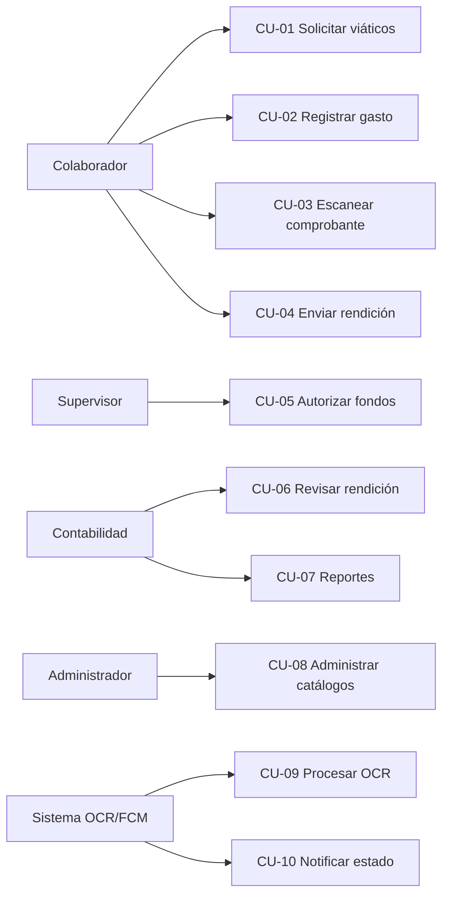
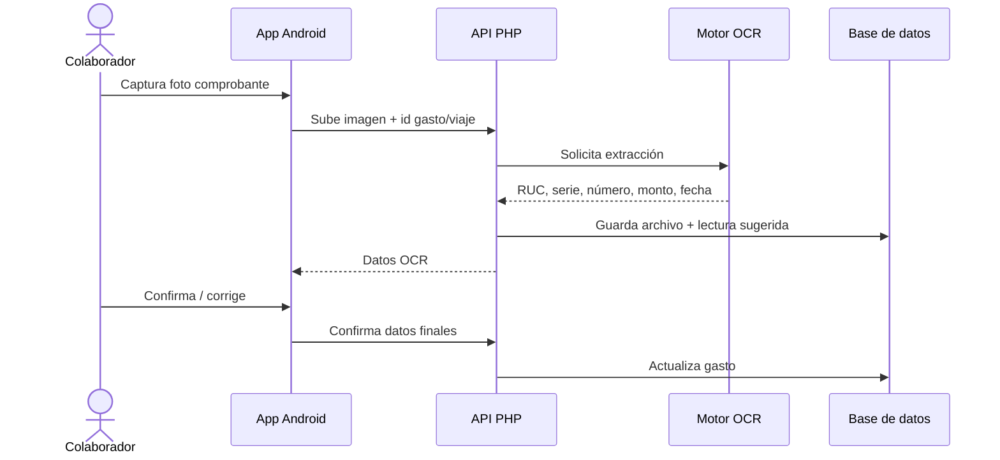

# Casos de uso — Viáticos G12

Diagramas en Mermaid para anexos / capítulo Desarrollo. Ajustar nombres de pantallas tras análisis de código.

## Diagrama de actores y casos (visión general)

## CU-01 Solicitar viáticos

| Campo | Detalle |
|-------|---------|
| Actor | Colaborador |
| Precondición | Usuario autenticado |
| Flujo básico | Abrir solicitud → datos viaje → monto → enviar |
| Postcondición | Solicitud en estado pendiente de autorización |
| Excepciones | Datos incompletos; usuario sin permiso |

## CU-03 Escanear comprobante (detalle)

## Matriz casos de uso ↔ RF

| CU | RF |
|----|-----|
| CU-01 | RF-02 |
| CU-02 | RF-05, RF-06 |
| CU-03 | RF-07, RF-08 |
| CU-04 | RF-09 |
| CU-05 | RF-03, RF-04 |
| CU-06 | RF-10, RF-15 |
| CU-07 | RF-12, RF-13 |
| CU-08 | RF-14 |
| CU-09 | RF-07 |
| CU-10 | RF-11 |
