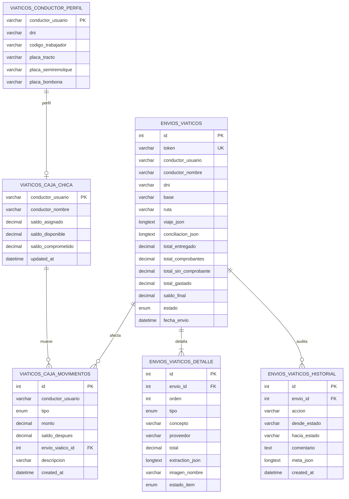

# Modelo entidad-relación — Viáticos G12 (schema real)

Fuente: `api/sql/viaticos_schema.sql` (BD `ginteroc_mega_sistema`) + inventario `docs/13`.  
Motor: **MySQL/InnoDB**, charset `utf8mb4`.

## Diagrama ER (tablas del schema leído)

## Estados de negocio (ENUM reales)

### `envios_viaticos.estado`
`enviado` → `revision_operaciones` → `revision_contabilidad` → `validacion_tesoreria` → `aprobado_cerrado`  
Alternativas: `observado`, `rechazado`.

### `envios_viaticos_detalle.estado_item`
`pendiente` | `aprobado` | `rechazado` | `observado`

### `envios_viaticos_detalle.tipo`
`comprobante` | `sin_comprobante`

### `viaticos_caja_movimientos.tipo`
`asignacion` | `rendicion` | `devolucion` | `reembolso` | `ajuste`

## Tablas adicionales citadas en PHP

`viaticos_schema.sql` **termina ~línea 250** (el `sed 250,500` vacío lo confirma).  
Estas tablas aparecen en PHP (`usuarios_purge`, tareo, API viaje); pueden crearse en otro script o en helpers:

| Tabla | Evidencia |
|-------|-----------|
| `viaticos_viajes` | PHP / API viaje |
| `viaticos_gastos` | PHP |
| `viaticos_viaje_aportes` | PHP |
| `viaticos_recarga_solicitudes` | PHP |
| `viaticos_preautorizacion` | PHP + `viaticos_preauth_excel.php` |
| `viaticos_preauth_terceros` | PHP |

Para el TAP basta documentarlas por uso en código; si aparece otro `.sql`, se anexa.

## Notas TAP

- Nombre lógico BD en comentario del script: `ginteroc_mega_sistema` (no pegar usuarios/contraseñas).  
- OCR: campo `extraction_json` en detalle; evidencia `imagen_nombre`.  
- Auditoría: `envios_viaticos_historial` append-only (Remitir / Devolver / ítems / rechazo).
