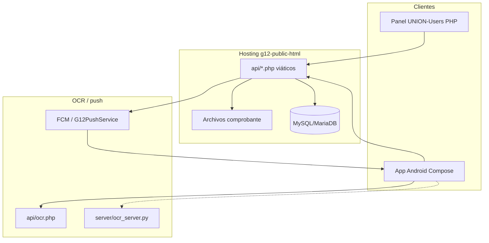
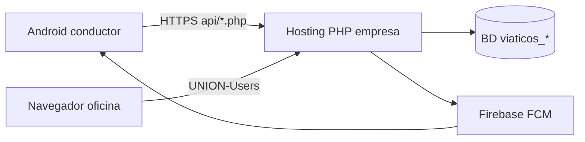

# Arquitectura — Web + App + API + BD + OCR + FCM (código real)

Inventario detallado: `docs/13-inventario-codigo-real.md`.  
Repos: `BLUTM0ND/g12-public-html`, `BLUTM0ND/g12-android-2222`.

---

## 1. Vista de contexto

---

## 2. Capas y archivos reales

| Capa | Ubicación real | Piezas clave |
|------|----------------|--------------|
| Presentación web | `UNION-Users/` | `viatico_detalle.php`, `viaticos_*_imprimir.php`, `viaticos_preauth_excel.php`, `assets/viaticos_admin.css` |
| Presentación móvil | `app/.../com/example/myapplication/` | `ViaticosActivity`, `RegistrarGastoActivity`, `EditarGastoActivity`, `OcrActivity` (+ `.kt.bak` / decompiled tesis) |
| API / aplicación | `api/` | `iniciar_viaje.php`, `viaje_activo.php`, `cerrar_viaje.php`, `enviar_viaticos.php`, `registrar_gasto.php`, `gasto_detalle.php`, `ocr.php`, `viaticos_viaje_helpers.php` |
| Datos | SQL + PDO | Tablas `viaticos_*`, `envios_viaticos*` — schema `api/sql/viaticos_schema.sql` |
| OCR | PHP + Python + app | `api/ocr.php`, `server/ocr_server.py`, `ComprobanteExtractor` / `OcrActivity` |
| Notificaciones | Android + backend | `G12PushService.kt`, `G12FcmHelper`, registro token FCM |

---

## 3. Endpoints API (módulo viáticos)

| Script | Función |
|--------|---------|
| `api/iniciar_viaje.php` | Iniciar viaje |
| `api/viaje_activo.php` | Obtener viaje activo |
| `api/cerrar_viaje.php` | Cerrar viaje |
| `api/enviar_viaticos.php` | Enviar rendición / envío |
| `api/registrar_gasto.php` | Registrar gasto |
| `api/gasto_detalle.php` | Detalle de gasto |
| `api/ocr.php` | OCR / parseo comprobante |
| `api/viaticos_viaje_helpers.php` | Utilidades compartidas |

Cliente Android: clase `ViaticosApi` (fuentes recuperadas / `.bak`).

---

## 4. App Android — mapa de pantallas viáticos

| Pantalla / clase | Responsabilidad |
|------------------|-----------------|
| `ViaticosActivity` | Home conductor: viajes, historial, refresh, notifs |
| `RegistrarGastoActivity` | Alta gasto: cámara, galería, PDF, OCR draft |
| `EditarGastoActivity` | Editar / eliminar gasto |
| `OcrActivity` | Revisión vouchers OCR, edición datos |
| Widgets `widget_viaticos_*` | Resumen en home launcher |
| `ViaticosReportGenerator` | Reportes |
| `G12PushService` / `G12FcmHelper` | Push FCM |

Nota académica: parte del fuente Kotlin de viáticos está en `.kt.bak` y `FUENTES_RECUPERADOS_TESIS/`; para el TAP citar ambas evidencias y el binario/APK en uso en pilotos.

---

## 5. Decisiones de arquitectura (TAP)

1. **Portal web monolítico PHP** (`g12-public-html`) con módulo viáticos embebido en `UNION-Users` + `api/`.  
2. **App Android** multi-módulo (viáticos + tareo/pedidos/OTM); el TAP delimita el **subdomínio viáticos**.  
3. **Misma BD** compartida; viajes y envíos son entidades centrales.  
4. **OCR híbrido**: app (`ComprobanteExtractor`) + `api/ocr.php` (+ opcional `ocr_server.py`).  
5. **Evidencia**: imágenes en `envios_viaticos_detalle.imagen_nombre`.  
6. **No documentar** passwords de hosting ni tokens en el Word.

---

## 6. Despliegue (borrador)

