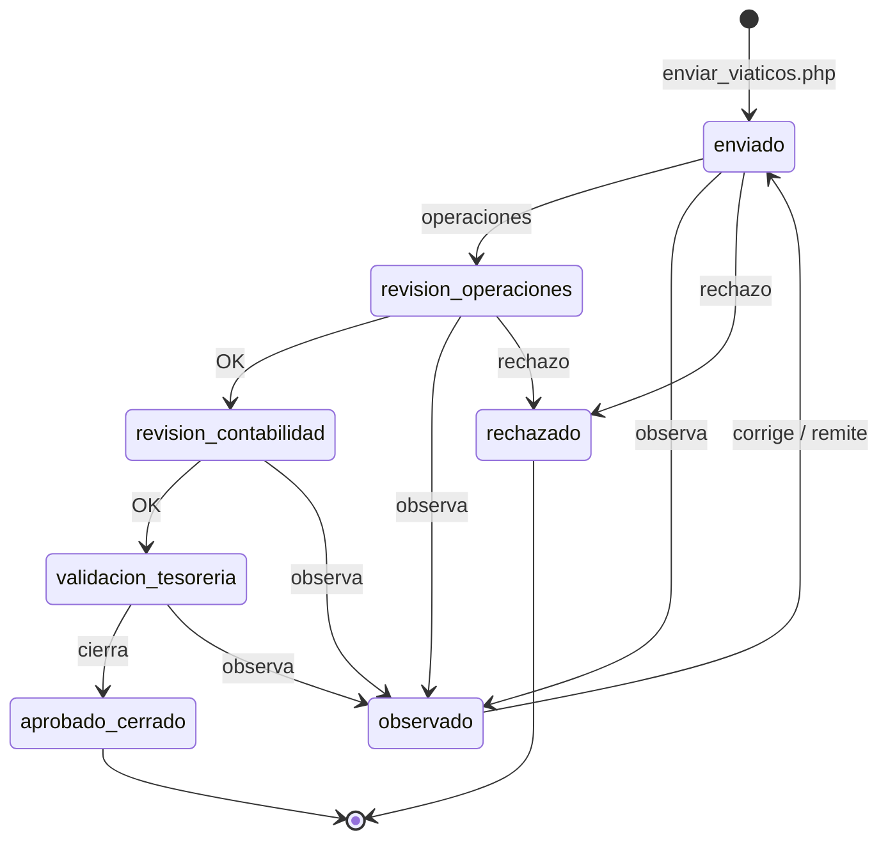

# Procesos del módulo de viáticos y BD (código real)

Ver también `docs/04-modelo-er.md`, `docs/09-arquitectura.md`, `docs/13-inventario-codigo-real.md`.

---

## 1. Proceso de negocio (macro, alineado a scripts)

Estados ENUM reales de `envios_viaticos.estado` (schema):  
`enviado`, `revision_operaciones`, `revision_contabilidad`, `validacion_tesoreria`, `observado`, `aprobado_cerrado`, `rechazado`.  
Historial append-only: `envios_viaticos_historial`.  
Caja: `viaticos_caja_chica` + movimientos (`asignacion|rendicion|devolucion|reembolso|ajuste`).

---

## 2. Procesos detallados ↔ artefactos

### P1 — Preautorización y apertura de viaje

1. Preautorización (`viaticos_preautorizacion`, terceros en `viaticos_preauth_terceros`).  
2. Export admin: `UNION-Users/viaticos_preauth_excel.php`.  
3. App/API: `api/iniciar_viaje.php` → fila en `viaticos_viajes`.  
4. Consulta: `api/viaje_activo.php`.

| Artefacto | Nombre real |
|-----------|-------------|
| Tablas | `viaticos_preautorizacion`, `viaticos_preauth_terceros`, `viaticos_viajes` |
| API | `iniciar_viaje.php`, `viaje_activo.php` |
| Web | `viaticos_preauth_excel.php` |
| App | `ViaticosActivity` / modelos `ViajeActivo`, `ViaticosViaje` |

### P2 — Fondos / aportes / caja

1. Aportes al viaje: `viaticos_viaje_aportes`.  
2. Recargas: `viaticos_recarga_solicitudes`.  
3. Caja chica: `viaticos_caja_chica` + `viaticos_caja_movimientos`.

| Artefacto | Nombre real |
|-----------|-------------|
| Tablas | `viaticos_viaje_aportes`, `viaticos_recarga_solicitudes`, `viaticos_caja_*` |
| Helpers | `api/viaticos_viaje_helpers.php` |

### P3 — Gastos y comprobantes (OCR)

1. Registro: `api/registrar_gasto.php` → `viaticos_gastos`.  
2. Detalle: `api/gasto_detalle.php`.  
3. Captura en app: `RegistrarGastoActivity` (cámara/galería/PDF).  
4. OCR: `OcrActivity` + `ComprobanteExtractor` + `api/ocr.php` (+ `server/ocr_server.py`).  
5. Edición: `EditarGastoActivity`.  
6. Gasto sin comprobante: `GastoFechaSinComprobante.kt` / `GastoSinComprobante`.

| Artefacto | Nombre real |
|-----------|-------------|
| Tablas | `viaticos_gastos` |
| API | `registrar_gasto.php`, `gasto_detalle.php`, `ocr.php` |
| App | `RegistrarGastoActivity`, `EditarGastoActivity`, `OcrActivity` |

### P4 — Envío / rendición y revisión web

1. Envío: `api/enviar_viaticos.php` → `envios_viaticos` + `envios_viaticos_detalle` (con `imagen_nombre`).  
2. Revisión oficina: `UNION-Users/viatico_detalle.php`.  
3. Impresiones: `viaticos_historial_imprimir.php`, `viaticos_viaje_imprimir.php`.  
4. Notificaciones dashboard: `UNION-Users/includes/notif_dashboard.php` (cuenta `envios_viaticos`).

### P5 — Cierre

1. `api/cerrar_viaje.php` cierra el ciclo del viaje.  
2. Widgets / historial app: `ViaticosHistorialCalendar`, widgets home.

---

## 3. Inventario BD

| Tabla | Relación clave | Notas |
|-------|----------------|-------|
| `viaticos_viajes` | `conductor_usuario`, `estado` | Núcleo del viaje |
| `viaticos_gastos` | `viaje_id` | Gastos del viaje |
| `viaticos_viaje_aportes` | `viaje_id` | Fondos/aportes |
| `viaticos_recarga_solicitudes` | `viaje_id` | Recargas |
| `viaticos_preautorizacion` | `conductor_usuario` | Preauth |
| `viaticos_preauth_terceros` | conductor | Terceros |
| `envios_viaticos` | cabecera envío | Rendición |
| `envios_viaticos_detalle` | `envio_id`, `imagen_nombre`, `orden` | Líneas + evidencia |
| `viaticos_caja_chica` | `conductor_usuario` | Caja |
| `viaticos_caja_movimientos` | `conductor_usuario` | Movimientos |

Schema: `api/sql/viaticos_schema.sql`, historial `api/sql/viaticos_historial.sql`.

---

## 4. Matriz proceso ↔ RF/CU/UI

| Proceso | RF (docs/02) | CU | UI web | UI app | Endpoint |
|---------|--------------|----|--------|--------|----------|
| P1 | RF-02..04 | CU-01,05 | preauth excel | ViaticosActivity | iniciar_viaje, viaje_activo |
| P2 | RF-04 | CU-05 | — | aportes en app | helpers |
| P3 | RF-05..08 | CU-02,03,09 | — | Registrar/Editar/OCR | registrar_gasto, ocr |
| P4 | RF-09..11 | CU-04,06,10 | viatico_detalle | envío desde app | enviar_viaticos |
| P5 | RF-15 | CU-06 | imprimir | historial | cerrar_viaje |

---

## 5. Transición (pendiente operativo)

Documentar en TAP aunque el desarrollo esté avanzado:

- Capacitar conductores (app: viaje → gasto → OCR → envío) y oficina (`viatico_detalle` / impresiones).  
- Datos maestros: usuarios/conductores, permisos app.  
- Criterio de cierre: N viajes `cerrados` sin incidencia crítica + manual breve.  
- Evidencia de pilotos (capturas) en anexos — sin datos personales sensibles.
